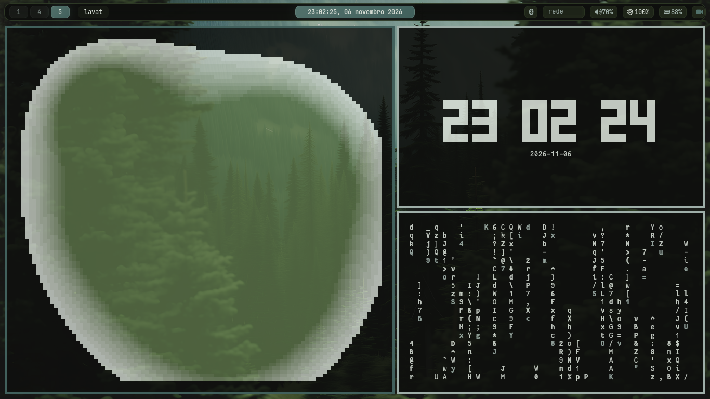

# Cadroc

Setup pessoal para o compositor Wayland **[mangowm](https://github.com/DreamMaoMao/mango)**
no **Arch Linux puro (rolling)**, com Waybar, SwayNC, Swaylock, Swayidle,
Fuzzel, Kitty e os scripts de apoio usados no dia a dia.

O repositório cobre as configurações principais do ambiente mangowm — não
apenas `~/.config/mango`.

> **cadrocfile e ruwall são opcionais.** O `install.sh` padrão não instala
> nenhum dos dois. Veja as seções específicas mais abaixo.

## Captura



*Waybar do mangowm com a paleta gerada a partir do wallpaper atual.*

## Estrutura

```
cadrocspace/
├── install.sh              # Instala pacotes das listas (oficial + AUR)
├── deploy.sh               # Copia configs/scripts do repo para ~/.config
├── check.sh                # Valida sintaxe dos scripts (.sh)
├── LICENSE                 # Licença MIT
├── screenshots/            # Capturas usadas no README
├── lista_pacman.txt        # Pacotes oficiais explícitos
├── lista_aur.txt           # Pacotes AUR explícitos
├── servicos.txt            # Serviços systemd a habilitar
├── .bashrc                 # PATH de ~/.local/bin e aliases básicos
├── defaults/               # Fonte versionada dos arquivos gerados de tema
│   ├── mango/              # theme.conf, waybar.jsonc, monitor.conf
│   ├── waybar/ swaync/ fuzzel/ kitty/ swaylock/ zathura/ cava/
└── .config/
    ├── mango/              # Config do mangowm
    │   ├── config.conf     # Config principal (layouts, efeitos, input)
    │   ├── bind.conf       # Atalhos de teclado e mouse
    │   ├── env.conf        # Variáveis de ambiente da sessão
    │   ├── rule.conf       # Regras de janelas e layer surfaces
    │   ├── theme.conf      # Cores do mangowm (gerado; semeado de defaults/)
    │   ├── waybar.jsonc    # Waybar com os módulos mango/* (gerado; semeado)
    │   ├── emoji-list.txt
    │   └── scripts/        # Scripts exclusivos do mangowm (mango-keys.sh)
    ├── scripts/            # Scripts compartilhados (lock, record, wallpaper, ...)
    │   ├── colors/         # Geradores de cor por aplicativo
    │   └── wallpapers/     # Geradores de wallpaper reproduzíveis
    ├── wallpapers/         # Wallpaper versionado (default-dark.png)
    ├── swayidle/           # Bloqueio/suspensão por inatividade
    ├── swaylock/           # Tela de bloqueio
    ├── swaync/             # Notificações
    ├── waybar/             # style.css e colors-waybar.css
    ├── cava/               # Visualizador de áudio (config, temas, shaders)
    ├── fastfetch/          # config.jsonc e ascii.txt
    ├── fuzzel/             # Launcher
    ├── kitty/              # Terminal
    └── zathura/            # Leitor de PDF
```

`~/.config/mango/monitor.conf` **não** está na árvore: é específico da máquina,
fica fora do git e é semeado vazio pelo `deploy.sh` (veja
[Monitores](#monitores)).

### Organização dos scripts

- **`.config/mango/scripts/`** — só o que depende do mangowm (lê `bind.conf`,
  usa `mmsg`, etc.).
- **`.config/scripts/`** — scripts compartilhados: lock, screenshot, gravação,
  wallpaper, clipboard, cores e utilitários.
- **`~/.local/bin/`** — apenas binários/ferramentas pessoais (`ruwall`,
  `cadrocfile`, etc.), nunca cópias de scripts versionados.

Os binds apontam para o caminho canônico `~/.config/scripts/...`.

## Pacotes

As listas foram geradas a partir dos **pacotes explícitos** instalados na
máquina de origem:

- `lista_pacman.txt` → `pacman -Qenq`
- `lista_aur.txt` → `pacman -Qemq`

> As listas refletem o setup completo da máquina, **não um mínimo funcional**.
> Elas incluem kernel, firmware, drivers e aplicativos que talvez você não
> queira. Revise antes de instalar, ou use `./install.sh --dry-run` para ver
> exatamente o que será feito.

O compositor e a Waybar com módulos `mango/*` vêm do AUR:

- `mangowm-git`
- `waybar-git`

## Instalação em uma máquina nova

Pré-requisitos: **Arch Linux puro (rolling)**, usuário com `sudo`, rede
funcionando e as ferramentas básicas:

```sh
sudo pacman -S --needed base-devel git curl rsync
```

Clone o repositório e instale:

```sh
git clone https://github.com/souandresouza/cadrocspace.git ~/cadrocspace
cd ~/cadrocspace

./install.sh --dry-run   # confira as listas
./install.sh             # instala pacotes oficiais + AUR
./install.sh --services  # opcional: habilita os serviços de servicos.txt

./deploy.sh              # copia as configs para ~/.config
./deploy.sh --generate   # opcional: gera as cores a partir do wallpaper
```

Depois saia da sessão e entre pelo SDDM escolhendo **Mango**. O arquivo de
sessão `/usr/share/wayland-sessions/mango.desktop` é fornecido pelo pacote
`mangowm-git`.

> Serviços específicos de outra máquina podem ser removidos de `servicos.txt`
> antes de rodar `--services`.

## Deploy e sincronização

O `deploy.sh` copia os arquivos (sem symlinks). O sentido padrão é
repositório → `~/.config`:

```sh
./deploy.sh              # copia e faz backup do que for substituído
./deploy.sh --dry-run    # mostra o que mudaria, sem alterar nada
./deploy.sh --generate   # depois de copiar, regenera as cores do tema atual
./deploy.sh --prune      # remove arquivos que saíram do repo
```

Para capturar mudanças feitas direto em `~/.config`:

```sh
./deploy.sh --pull       # ~/.config -> repo (só o default-dark.png nos wallpapers)
git diff                 # revise
git add -A && git commit -m "..."
```

Backups dos arquivos substituídos ficam em
`~/.cache/cadrocspace/backups/<timestamp>/`.

## Arquivos gerados de tema

Cores de aplicativos mudam a cada wallpaper, então **não são versionadas**.
O repositório guarda apenas a fonte em `defaults/`, e o `deploy.sh`:

1. copia as configs normais do repo para `~/.config`;
2. **semeia** de `defaults/` os arquivos gerados que faltarem (ambiente
   funcional antes da primeira paleta);
3. com `--generate`, roda `~/.config/scripts/run-scripts.sh` para renderizar
   tudo com a paleta do wallpaper atual.

Gerados assim: `mango/theme.conf`, `mango/waybar.jsonc`,
`mango/monitor.conf`, `waybar/colors-waybar.css`, `swaync/colors-swaync.css`,
`fuzzel/colors-fuzzel.ini`, `kitty/colors-kitty.conf`, `swaylock/config`,
`zathura/zathurarc` e `cava/themes/colors`.

Consequências práticas:

- `./deploy.sh --dry-run` para de acusar drift a cada troca de wallpaper.
- `--pull` **não** traz esses arquivos de volta (eles são saída, não fonte).
  Para mudar estrutura (ex.: módulos da Waybar), edite a cópia em `defaults/`
  e rode `./deploy.sh`.
- Ajustes locais de cor/fonte vão para o estado do tema
  (`~/.local/state/cadrocspace/state/state.env`) e sobrevivem ao deploy.

## Monitores

As regras de monitor são específicas da máquina e ficam em
`~/.config/mango/monitor.conf` (fora do git, semeado vazio pelo deploy).
Sem regras, o mango configura cada saída com o modo preferido.

Para regras explícitas (resolução, taxa, posição, escala), rode:

```sh
~/.config/scripts/detect-monitors.sh            # mostra as regras
~/.config/scripts/detect-monitors.sh --write    # grava em monitor.conf
mmsg dispatch reload_config                     # aplica sem reiniciar
```

O script lê `wlr-randr` e gera uma linha `monitor_rule=` por monitor
habilitado. Revise o arquivo antes de aplicar — posições/escala podem precisar
de ajuste manual. A sintaxe completa está na
[wiki do mango](https://github.com/mangowm/mango/wiki/monitors).

## Ajustes que você provavelmente precisa fazer

Alguns valores são específicos do hardware/uso da máquina de origem:

- **Monitores** — ficam em `~/.config/mango/monitor.conf` (fora do git). O
  `deploy.sh` semeia o arquivo vazio e o mango detecta as telas sozinho; para
  gerar regras explícitas a partir da sessão atual rode
  `~/.config/scripts/detect-monitors.sh --write` e depois
  `mmsg dispatch reload_config`. Veja [Monitores](#monitores).
- **Teclado** — `xkb_rules_layout=br` (Português do Brasil) em `config.conf`.
  Troque se necessário.
- **Bateria** — detectada automaticamente (primeira em
  `/sys/class/power_supply`). Waybar e `battery_tracker.sh` não fixam mais
  `BAT1`; para forçar outra, use `CADROC_BATTERY_DIR`.
- **wlsunset** — usa geoclue quando disponível; sem ele, cai em Florianópolis.
  Ajuste com `WLSUNSET_LAT` / `WLSUNSET_LON` (ou edite `wlsunset.sh`).
- **Fontes** — o tema usa `JetBrainsMono Nerd Font` (pacote
  `ttf-jetbrains-mono-nerd`, nas listas). Troque em
  `~/.local/state/cadrocspace/state/state.env` (`FONT_FAMILY`/`FONT_SIZE`) e
  rode `~/.config/scripts/run-scripts.sh`.
- **Polkit** — `polkit-agent.sh` inicia o primeiro agente instalado
  (KDE, GNOME, MATE ou XFCE), sem depender de um caminho fixo.
- **Pastas de saída** — screenshots vão para `~/Imagens/Screenshots` e
  gravações para `~/Vídeos`. Crie os diretórios ou edite os scripts.
- **fcitx5** — `env.conf` define variáveis de IM do fcitx5, mas o pacote não
  está nas listas. Se não usar fcitx5, remova essas linhas ou instale-o.
- **cadrocfile** — o bind `SUPER+E` chama `cadrocfile`. Se não usar o
  gerenciador (ele é opcional), remova ou troque essa linha em `bind.conf`.
- **Regras por monitor** — em `rule.conf`, regras de janela que citam
  `monitor:eDP-1`/`monitor:HDMI-A-1` só valem em máquinas com esses nomes;
  nas demais, o mango simplesmente ignora a regra e a janela abre onde estiver.

## Waybar

A Waybar do mangowm fica em `~/.config/mango/waybar.jsonc` e usa os módulos
`mango/workspaces` e `mango/window` do `waybar-git`.

O visual é definido por `~/.config/waybar/style.css` e
`~/.config/waybar/colors-waybar.css` (paleta gerada a partir do wallpaper).

Os módulos `custom/recorder` e `custom/recordertime` chamam
`~/.config/scripts/record.sh`: o ícone inicia/para a gravação e o tempo só
aparece enquanto há uma gravação ativa.

O mangowm inicia a barra com:

```conf
exec_once=waybar -c ~/.config/mango/waybar.jsonc -s ~/.config/waybar/style.css
```

Atalhos úteis:

- `SUPER+P` — recarrega a Waybar
- `SUPER+K` — abre/fecha a central de notificações do SwayNC

## Cores e tema dinâmico (ruwall ou pywal)

O script `~/.config/scripts/run-scripts.sh` gera a paleta a partir do wallpaper
e atualiza as cores de Waybar, Kitty, Fuzzel, SwayNC, Swaylock, Cava, Zathura,
do próprio mangowm (`theme.conf`) e do calendário da Waybar (os hex dentro de
`mango/waybar.jsonc`).

Por padrão ele usa o **ruwall**:

```sh
~/.config/scripts/run-scripts.sh
~/.config/scripts/run-scripts.sh ~/.config/wallpapers/default-dark.png
```

Se preferir o **pywal** (também opcional):

```sh
PALETTE_TOOL=wal ~/.config/scripts/run-scripts.sh
```

Sem ruwall/pywal, os arquivos de `defaults/` continuam valendo como fallback
(semeados pelo `deploy.sh`) e o `random-wallpaper.sh` ainda troca o papel de
parede, mas não regenera a paleta.

O `random-wallpaper.sh` (`SUPER+H`) percorre todos os wallpapers da pasta antes
de repetir qualquer um. O ciclo fica em
`~/.cache/wallpapers/wallpaper_cycle.txt`.

## Atalhos principais

| Atalho | Ação |
|:---|:---|
| `SUPER+Return` | Kitty |
| `SUPER+E` | cadrocfile (opcional) |
| `SUPER+B` | Brave |
| `SUPER+SHIFT+B` | Firefox (opcional) |
| `SUPER+Space` | Fuzzel |
| `SUPER+T` | Telegram |
| `SUPER+W` | btop |
| `SUPER+N` | nmtui |
| `SUPER+S` | tty-clock |
| `SUPER+D` | bluetui |
| `SUPER+Y` | yazi |
| `SUPER+U` | Seletor de emoji |
| `SUPER+L` | Bloquear a tela |
| `SUPER+P` | Recarregar a Waybar |
| `SUPER+K` | Central de notificações |
| `SUPER+A` | Ver atalhos do mangowm |
| `SUPER+C` | Color picker |
| `SUPER+H` | Trocar wallpaper |
| `SUPER+V` | Histórico do clipboard |
| `SUPER+SHIFT+O` | Teclado virtual na tela (mostrar/esconder) |
| `SUPER+SHIFT+G` | Gravar a tela |
| `SUPER+M` | Menu de saída/suspensão |
| `SUPER+Q` | Fechar a janela focada |
| `SUPER+SHIFT+Q` | Sair do mangowm |
| `ALT+1..9` | Ir para a tag 1..9 |
| `SUPER+1..9` | Mover a janela para a tag 1..9 |
| `ALT+Tab` | Visão geral (overview) |
| `ALT+F` | Tela cheia |
| `ALT+Z` | Scratchpad |
| `Print` | Screenshot de todos os monitores |
| `ALT+Print` | Screenshot do monitor |
| `CTRL+Print` | Screenshot de uma região |
| `SHIFT+Print` | Screenshot com anotação (satty) |
| `SUPER+Print` | Extrair texto (OCR) de uma região |
| `SUPER+SHIFT+Print` | Ler um QR code de uma região |

O OCR e o QR copiam o resultado para o clipboard. O OCR usa o `tesseract`
(modelos `por`/`eng`); o QR usa o `zbar`. Se os dados do tesseract não estiverem
em `/usr/share/tessdata`, o script recorre a
`~/.local/share/tesseract/tessdata`.

O teclado virtual usa o `wvkbd` (AUR) e alterna com `SUPER+SHIFT+O`. Ele ajuda
quando alguma tecla do notebook falha e também evita teclas físicas (útil
contra keyloggers de hardware); não protege contra keylogger de software.

Para ter uma tecla `ç`/`Ç` dedicada (ao lado do `L`, como no ABNT2), rode
`.config/scripts/wvkbd/build-ptbr.sh`: ele compila um `wvkbd-ptbr` em
`~/.local/bin`, que o `osk.sh` passa a preferir automaticamente. Sem esse
binário, o `ç` continua acessível pelo `Cmp` → `c`.

A lista completa e sempre atualizada fica em `.config/mango/bind.conf` e pode
ser aberta com `SUPER+A`.

## cadrocfile (opcional)

O [cadrocfile](https://github.com/souandresouza/cadrocfile) é um gerenciador de
arquivos GTK4 + Libadwaita.

**É totalmente opcional.** O `install.sh` padrão não o instala. Se você não for
usá-lo, remova ou troque o bind `SUPER+E`; o restante da configuração do
mangowm continua normal.

Instalação pelo repositório:

```sh
cd ~/cadrocspace
./install.sh --cadrocfile
```

Ou manualmente:

```sh
git clone https://github.com/souandresouza/cadrocfile ~/cadrocfile
cd ~/cadrocfile
./install.sh
```

As configurações do cadrocfile ficam em `~/.config/cadrocfile/`.

## ruwall (opcional)

O [ruwall](https://github.com/souandresouza/ruwall) é um port em Rust do
`pywal`. Ele gera a paleta a partir do wallpaper e aplica nos aplicativos
(via scripts deste repositório).

**É totalmente opcional.** O `install.sh` padrão não o instala. Sem ele, os
arquivos de cor versionados servem de fallback. Se quiser tema dinâmico sem
compilar o ruwall, use o `pywal` com `PALETTE_TOOL=wal`.

Instalação pelo repositório:

```sh
cd ~/cadrocspace
./install.sh --ruwall
```

Ou manualmente:

```sh
git clone https://github.com/souandresouza/ruwall ~/ruwall
cd ~/ruwall
cargo build --release
install -m755 target/release/ruwall ~/.local/bin/ruwall
```

Uso básico:

```sh
ruwall -i ~/Imagens/wallpapers/meu-wallpaper.jpg
ruwall -R
```

Os caches ficam em `~/.cache/wal/`.

## Atualizando as listas de pacotes

Quando instalar/remover pacotes explicitamente, regenere as listas:

```sh
./install.sh --update-lists
git add lista_*.txt && git commit -m "Atualizar lista de pacotes"
```

O `--update-lists` regenera as listas a partir dos pacotes explícitos da
máquina atual. Revise o resultado antes de commitar.

## Validação

```sh
./check.sh               # sh -n / bash -n em todos os scripts
./check.sh --shellcheck  # também roda shellcheck (se instalado)
./check.sh --deps        # confere os comandos usados pela sessão
./check.sh --all         # sintaxe + shellcheck + dependências
mango -p -c ~/.config/mango/config.conf   # valida a config do mangowm
```

O `.shellcheckrc` na raiz desativa alguns avisos que são falsos positivos
estruturais (source dinâmico, variáveis de paleta compartilhadas entre scripts
e expressões literais dentro de aspas simples).

## Notas

- **Wallpaper padrão**: só `~/.config/wallpapers/default-dark.png` é
  versionado. Outros wallpapers são pessoais e ficam fora do git.
- **Arquivos de cor** (`colors-*`, `cava/themes/colors`, `zathurarc`,
  `swaylock/config`, `mango/theme.conf`) e os hex do calendário em
  `mango/waybar.jsonc` são gerados pelo `run-scripts.sh` a partir do wallpaper.
  Eles ficam no repositório como fallback para o primeiro boot e são
  sobrescritos quando você troca o tema.
- **Tela de bloqueio**: `swayidle` bloqueia após 5 minutos e suspende após 15
  minutos (`~/.config/swayidle/config`). Ajuste os tempos como quiser.
- **Gravação de tela**: `record.sh` usa `wl-screenrec` por padrão e aceita
  `--gpu` para usar `gpu-screen-recorder`.

## Licença

Distribuído sob a licença **MIT**. Veja [LICENSE](LICENSE).
